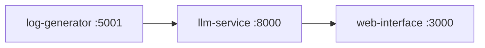

# LLM Log Explainer

Three Docker services: generate realistic app logs, classify/explain them, show both on a small dashboard.

**Owners:** [Aaditya Upadhyay](https://github.com/Addy48) (Docker, generator, infra) · Rasagya Vatsal (LLM service, training)

<p align="center">
  
  
  
</p>

[](https://github.com/Addy48/llm-log-explainer/actions/workflows/incident-drill.yml)

---

## Architecture



| Service | Role |
|---------|------|
| `log-generator` | Flask. Random logs + six correlated failure scenarios |
| `llm-service` | FastAPI. `/explain`, `/explain-batch`, `/fetch-and-explain` |
| `web-interface` | Static dashboard |

Live `/explain` uses the rule engine in `llm-service/analyzer.py`. DistilBERT training + `evaluate.py` are an optional experiment (deps in `requirements-train.txt`); weights are Git LFS and not used by the live API.

---

## Run locally (no Docker)

```bash
./run_local.sh
```

Sets up `.venv`, starts generator (:5001), API (:8000) and dashboard (:3000), opens the browser. `Ctrl+C` stops all.
Optional LLM explanations: copy `.env.example` to `.env` and set `GROQ_API_KEY`.

Tests: `.venv/bin/python -m pytest llm-service log-generator scripts`

## How explanations work

- `llm-service/analyzer.py` tags each line with a category, severity and the signal words that matched; confidence = how clearly the top category beats the runner-up.
- Lines roll up into an incident: status, health score, timeline, root cause, actions.
- `llm-service/llm.py` (optional, Groq `openai/gpt-oss-120b`) writes a plain-language incident explanation and points to key lines.
- Paste raw logs (ISO, `[LEVEL]`, JSON lines, HDFS) via the dashboard or `POST /analyze-text`.

## Quick start (Docker)

```bash
git clone https://github.com/Addy48/llm-log-explainer.git
cd llm-log-explainer
docker compose up --build
```

Skip LFS if you only want the API:

```bash
GIT_LFS_SKIP_SMUDGE=1 git clone https://github.com/Addy48/llm-log-explainer.git
```

| URL | Service |
|-----|---------|
| http://localhost:5001 | Log generator |
| http://localhost:8000 | LLM service (`/docs`) |
| http://localhost:3000 | Dashboard |

---


## Cloud automation: AIOps incident drill

The [GitHub Actions incident drill](docs/INCIDENT-DRILL.md) runs the project tests, builds the Docker Compose stack, and sends a selectable failure scenario through the real log generator and analyzer. Its job summary reports the diagnosis and a simulated release-gate decision; it does not deploy the app. Trigger it from **Actions → AIOps Incident Drill → Run workflow** and choose one of the six scenarios.

## API (short)

**POST /explain**

```json
{ "timestamp": "2026-02-01T10:30:00Z", "level": "ERROR", "message": "Connection timeout to database" }
```

Contract: [API-CONTRACT.md](API-CONTRACT.md)

Generator also exposes `/generate`, `/generate/batch`, `/scenario/<name>` (`database_failure`, `auth_breach`, `memory_leak`, `api_overload`, `disk_failure`, `redis_cache_stampede`).

---

## Train (optional)

```bash
cd llm-service
pip install -r requirements-train.txt
python prepare_data.py
python train.py
python evaluate.py
```

---

## Layout

```
log-generator/     Flask app
llm-service/       FastAPI + train/eval
web-interface/     dashboard
docker-compose.yml
```
