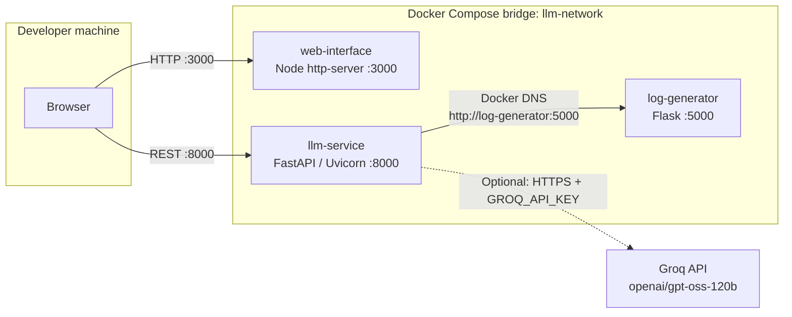
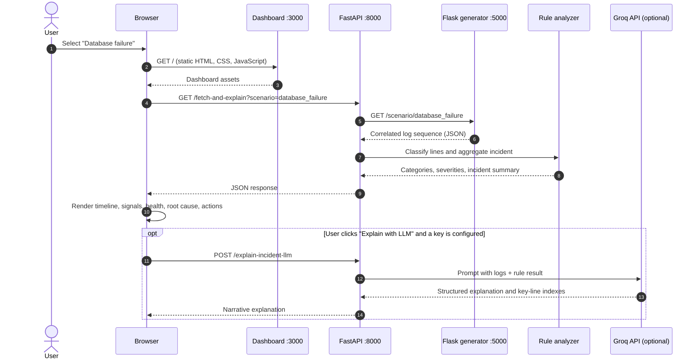

# LLM Log Explainer

A small AIOps demonstration that turns generated or pasted application logs into explainable incident summaries. It combines a deterministic rules engine, an optional Groq-hosted LLM explanation, a browser dashboard, Docker Compose, and a GitHub Actions incident drill.

**The live API uses rules, not the DistilBERT experiment.** The LLM is optional and adds a narrative after the rules engine has classified the incident.

<p align="center">
  
  
  
  
</p>

[](https://github.com/Addy48/llm-log-explainer/actions/workflows/incident-drill.yml)

**Owners:** [Aaditya Upadhyay](https://github.com/Addy48) · Rasagya Vatsal

## Contents

- [What the project does](#what-the-project-does)
- [Architecture](#architecture)
- [Incident scenarios](#incident-scenarios)
- [How analysis works](#how-analysis-works)
- [Run with Docker Compose](#run-with-docker-compose)
- [Run without Docker](#run-without-docker)
- [API reference and examples](#api-reference-and-examples)
- [GitHub Actions incident drill](#github-actions-incident-drill)
- [Configuration and secrets](#configuration-and-secrets)
- [Tests and development](#tests-and-development)
- [Training experiment](#training-experiment)
- [Cloud mapping and limitations](#cloud-mapping-and-limitations)
- [Repository layout](#repository-layout)
- [Troubleshooting](#troubleshooting)

## What the project does

- Generates realistic single logs, batches, and correlated failure sequences.
- Classifies each line by category and severity, with confidence and matched signals that make the decision inspectable.
- Groups a sequence into an incident with a health score, timeline, root cause, and recommended actions.
- Accepts pasted log text in common formats: ISO timestamps, `[LEVEL]` lines, JSON lines, and HDFS-style lines.
- Optionally asks an external LLM to turn the rule-based incident into a short plain-language explanation and identify key lines.
- Runs as three services with one Docker Compose command; healthchecks hold dependent startup until the API and generator respond.
- Runs an API-level incident drill in GitHub Actions and saves a JSON report. The workflow validates behavior; it does not deploy the application.

## Architecture

The browser downloads the static dashboard from port `3000`, then its JavaScript calls the API directly on port `8000`. Inside Compose, the API reaches the generator through Docker DNS at `log-generator:5000`. The optional LLM request leaves the API container and goes to Groq.



> **Local-process mode:** `run_local.sh` keeps the same responsibilities and host ports, but points the API at `http://localhost:5001` instead of using Compose DNS.

| Service | Technology | Container port | Host port | Responsibility |
|---|---|---:|---:|---|
| `log-generator` | Python 3.11, Flask | `5000` | `5001` | Random logs, batches, health, and six failure scenarios |
| `llm-service` | Python 3.11, FastAPI, Uvicorn | `8000` | `8000` | Rules analysis, incident aggregation, API docs, optional LLM call |
| `web-interface` | Node 20, `http-server` | `3000` | `3000` | Serves the dashboard files; the browser calls the API separately |

Compose creates a bridge network named `llm-network`. `depends_on: condition: service_healthy` makes the API wait for the generator healthcheck and the dashboard wait for the API healthcheck. The healthchecks report readiness; they do not by themselves restart a process that is alive but unhealthy. `restart: unless-stopped` restarts a container when its process exits.

### Request flow: replay a failure



## Incident scenarios

The generator exposes six correlated scenario names. The expected category is also checked by the incident-drill script.

| Scenario | Expected category | Example signals |
|---|---|---|
| `database_failure` | `database` | Connection timeouts, retries, database fallback |
| `auth_breach` | `security` | Brute-force login attempts, lockout, security response |
| `memory_leak` | `memory` | Rising heap use, failed garbage collection, exhaustion |
| `api_overload` | `traffic` | Rate limiting, queue/latency pressure, scaling response |
| `disk_failure` | `storage` | SMART/sector warnings, failed writes, volume failover |
| `redis_cache_stampede` | `cache` | Expired cache entries, concurrent misses, thundering herd |

Details: [Failure scenarios and log taxonomy](docs/FAILURE_SCENARIOS.md).

## How analysis works

### Per-line classification

1. The analyzer lowercases the message and module, then scores matching weighted keywords for categories such as database, security, memory, traffic, storage, cache, config, and network.
2. The category with the highest signal score wins. The result includes the matched signals as evidence. With no category signal, it returns `general` with confidence `0.35`.
3. Confidence is deterministic. If `top` and `runner_up` are the two highest category scores, then:

   ```text
   margin   = (top - runner_up) / top
   strength = min(top, 8) / 8
   confidence = round(0.45 + 0.35 × margin + 0.20 × strength, 2)
   ```

4. Severity starts with the log-level base score (for example, ERROR `4`, WARNING `2`, INFO `0`), adds configured escalation words, and subtracts calming words. Risk `>= 6` is `HIGH`; risk `>= 2` is `MEDIUM`; otherwise it is `LOW`.

### Incident aggregation

For `H` HIGH and `M` MEDIUM lines:

```text
health_score = max(0, 100 - 18 × H - 6 × M)
```

- `critical`: at least two HIGH lines
- `degraded`: one HIGH line, or at least three MEDIUM lines
- `stable`: otherwise

The analyzer also creates a severity timeline, a root-cause summary, and recommended actions. The numbers are deterministic heuristics for an educational demo, not a production SLO or a trained incident-risk model.

### Optional LLM explanation

The LLM receives the log lines and the rules engine's incident summary. It returns a title, a short summary, a root cause, actions, and indexes of key lines. The dashboard and rule-based analysis still work without `GROQ_API_KEY`; only the narrative button is disabled. The CI drill deliberately uses this deterministic path and needs no LLM secret.

## Run with Docker Compose

You need Docker Desktop (or another Docker Engine with Compose) running.

```bash
# If Git LFS is installed, skip downloading the unused training weights.
GIT_LFS_SKIP_SMUDGE=1 git clone https://github.com/Addy48/llm-log-explainer.git
cd llm-log-explainer

# Optional: enable the LLM-written narrative before starting.
cp .env.example .env
# Edit .env and set GROQ_API_KEY only if you want that feature.

docker version                 # verify both Client and Server are shown
docker compose up -d --build
docker compose ps
```

Open:

- Dashboard: <http://localhost:3000>
- FastAPI Swagger UI: <http://localhost:8000/docs>
- API health: <http://localhost:8000/health>
- Generator health: <http://localhost:5001/health>

The first build downloads base images and installs dependencies. Compose waits for the generator and API healthchecks before starting dependent services.

Stop and remove the containers/network when finished:

```bash
docker compose down
```

Remove built images too, only if you want to reclaim that disk space:

```bash
docker compose down --rmi local
```

## Run without Docker

The local runner starts the same three applications as Python/Node processes and does not need Docker:

```bash
./run_local.sh
```

It creates/uses `.venv`, installs the Python requirements, starts the generator on `5001`, API on `8000`, dashboard on `3000`, then opens the dashboard. Press `Ctrl+C` in that terminal to stop it. The script stops only its own prior project processes and exits with a message if one of the required ports belongs to another program.

## API reference and examples

The API reference is documented in [API-CONTRACT.md](API-CONTRACT.md); interactive schemas are available at <http://localhost:8000/docs> while the API is running.

### Test a generated failure

```bash
curl -sS "http://localhost:8000/fetch-and-explain?scenario=database_failure" | python -m json.tool
```

### Analyze a log directly

```bash
curl -sS -X POST http://localhost:8000/explain \
  -H 'Content-Type: application/json' \
  -d '{"level":"ERROR","message":"Database connection failed after 5 retries","context":{"module":"db_handler"}}' \
  | python -m json.tool
```

### Analyze pasted log text

```bash
curl -sS -X POST http://localhost:8000/analyze-text \
  -H 'Content-Type: application/json' \
  -d '{"text":"2026-10-26T10:00:00Z ERROR Database connection timeout\n2026-10-26T10:00:02Z WARN Retry exhausted"}' \
  | python -m json.tool
```

### Check the generator directly

```bash
curl -sS http://localhost:5001/health | python -m json.tool
curl -sS http://localhost:5001/scenario/database_failure | python -m json.tool
```

The generator also supports `/generate`, `/generate/batch?count=10`, `/generate/error`, `/generate/warning`, and `/generate/info`.

## GitHub Actions incident drill

`.github/workflows/incident-drill.yml` runs for pull requests and pushes to `main`. After the workflow is on the default branch, **Actions → AIOps Incident Drill → Run workflow** lets you choose a scenario.

```mermaid
flowchart LR
  Event[Pull request / push / manual scenario] --> Runner[GitHub-hosted Ubuntu runner]
  Runner --> Tests[Install dependencies + pytest]
  Tests --> Compose[Validate Compose + build/start services]
  Compose --> Drill[Replay selected incident through real API]
  Drill --> Validate[Check expected category and incident fields]
  Validate --> Summary[Job summary + JSON artifact]
  Summary --> Cleanup[Compose down]
```



The run validates the category, severity counts, health score, status, root cause, actions, and analyzed-log count. The job summary shows a **simulated** release decision: `critical → BLOCKED`, `degraded → REVIEW`, `stable → APPROVED`. A green job means the diagnosis check passed; it can still report `BLOCKED` because that is the correct simulated response to a critical incident. **No deployment, image publishing, or AWS access is configured.**

To run the same check locally, start the Compose stack first:

```bash
python scripts/incident_drill.py --scenario database_failure
python scripts/incident_drill.py --scenario redis_cache_stampede
```

The script writes `incident-report.json`. GitHub Actions uploads the report as `incident-report-<scenario>` for seven days. Full details: [GitHub Actions incident drill](docs/INCIDENT-DRILL.md).

## Configuration and secrets

| Variable | Purpose | Default |
|---|---|---|
| `GROQ_API_KEY` | Enables optional LLM-written explanations | Empty/disabled |
| `LLM_MODEL` | Groq model name | `openai/gpt-oss-120b` |
| `LLM_API_URL` | OpenAI-compatible chat completions endpoint | Groq API URL in `llm-service/llm.py` |
| `LOG_GENERATOR_URL` | Generator URL used by the API | `http://log-generator:5000` in Compose; `http://localhost:5001` in `run_local.sh` |

`.env.example` contains placeholders only. `.env` is ignored by Git. Never commit API keys or paste them into CI logs. The incident drill uses the rules engine and does not require a secret.

## Tests and development

Install dependencies in the local virtual environment with `./run_local.sh`, then run:

```bash
.venv/bin/python -m pytest -p no:cacheprovider llm-service log-generator scripts
```

The suite covers the analyzer, API, generator scenarios, and incident-drill validation. GitHub Actions installs the declared requirements in a clean Python 3.11 runner and runs the same test paths before building containers.

Useful commands:

```bash
docker compose ps                         # service state and published ports
docker compose logs -f llm-service        # follow API logs
docker compose logs -f log-generator      # follow generated-log service
docker compose exec llm-service sh        # shell inside the API container
docker compose config --quiet             # validate the Compose model
```

## Training experiment

`llm-service/train.py`, `prepare_data.py`, and `evaluate.py` are a separate DistilBERT training/evaluation path. The live API does **not** load that model; it uses the explainable rule engine. Training dependencies are isolated in `llm-service/requirements-train.txt`, and model weights are stored with Git LFS.

To experiment with training, clone without skipping LFS, then:

```bash
cd llm-service
pip install -r requirements-train.txt
python prepare_data.py
python train.py
python evaluate.py
```

Treat the training metrics cautiously: the included labeled dataset is class-imbalanced, so overall accuracy alone can be misleading.

## Cloud mapping and limitations

| Cloud concept | Demonstrated here | Production extension (not included) |
|---|---|---|
| Containerization | One Docker image per service | Scan, sign, and publish versioned images |
| Orchestration | Docker Compose on one machine | ECS/Fargate or Kubernetes for multi-node scheduling |
| Infrastructure as code | Compose declares services, ports, networks, and healthchecks | Terraform or CloudFormation for cloud resources |
| CI | GitHub Actions tests and runs a real incident drill | Add approvals and deployment jobs when a target environment exists |
| Artifact storage | JSON incident report retained by Actions for seven days | S3 or an observability/incident platform |
| Secrets | `.env` locally; CI drill needs no key | AWS Secrets Manager / task role in ECS |
| Operations intelligence | Rules classify incidents; optional LLM explains them | Production telemetry, alert routing, access control, SLOs |

This is a learning/demo application, not a production-ready log platform. It has no authentication, authorization, persistent incident database, or configured cloud deployment. The API enables permissive CORS for the local dashboard. Do not expose these ports publicly without adding appropriate network restrictions, TLS, authentication, secret management, and operational monitoring.

## Repository layout

```text
.
├── Project Details.md                    # concise current-state reference
├── .github/workflows/incident-drill.yml  # CI + incident replay + report artifact
├── docs/
│   ├── FAILURE_SCENARIOS.md              # scenario taxonomy
│   └── INCIDENT-DRILL.md                 # workflow design and instructions
├── llm-service/
│   ├── api.py                            # FastAPI routes and service integration
│   ├── analyzer.py                       # deterministic classification/aggregation
│   ├── llm.py                            # optional Groq explanation client
│   ├── Dockerfile
│   └── requirements-train.txt            # isolated model-training dependencies
├── log-generator/
│   ├── app.py                            # Flask log and scenario endpoints
│   └── Dockerfile
├── scripts/
│   ├── incident_drill.py                 # live-stack CI/demo checker
│   └── test_incident_drill.py
├── web-interface/                        # static dashboard
├── API-CONTRACT.md                       # request/response contract
├── docker-compose.yml                    # local service topology and healthchecks
└── run_local.sh                          # non-Docker fallback
```

The compact [Project Details](Project%20Details.md) page points to the current source documents. The dated proposal under `docs/archive/` is retained as history and is not a runbook.

## Troubleshooting

| Symptom | What to check |
|---|---|
| Docker CLI shows only Client | Open Docker Desktop, wait for Engine running, then retry `docker version` |
| Port already in use | Check `docker compose ps`; stop the other run or identify the listener with `lsof -i :3000 -i :5001 -i :8000` |
| Dashboard opens but services are red | Check `docker compose ps` and `docker compose logs llm-service log-generator` |
| LLM says it is off | Set `GROQ_API_KEY` in `.env`, then restart with `docker compose up -d` |
| LLM returns 401 or 429 | Check the key/model or provider rate limit; the rules-based diagnosis remains available |
| Dashboard looks stale | Hard refresh with `Cmd+Shift+R` |
| Browser cannot reach API on port 8000 | Ensure the API container/local service is running and port `8000` is published |
